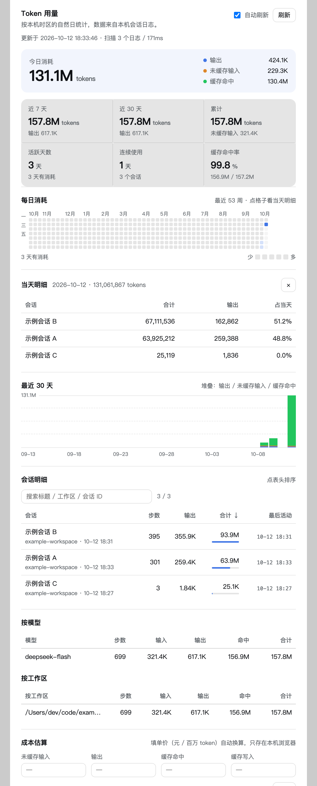
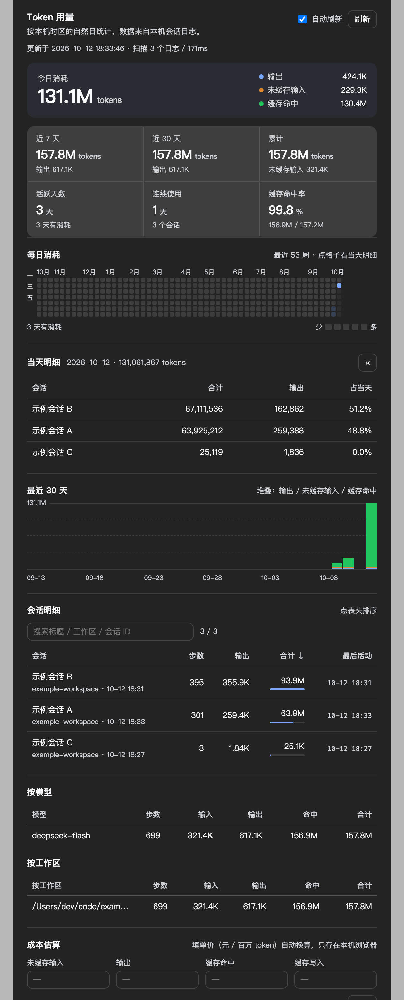

# dsh-token-usage-panel

[](https://github.com/topics/dsh-plugin)
[](LICENSE)
[](#兼容性)

> **在 DeepSeek Harness 的「设置」里看每天花了多少 Token。**
> 不用离开 DSH，也不用另开网页：设置 → `Token 用量`，就是一张 GitHub 风格的每日消耗热力图。

浅色主题：



深色主题：



---

## 功能

- **今日消耗**：总量，加上「输出 / 未缓存输入 / 缓存命中」三色明细；填了单价还会显示当天估算金额。
- **指标网格**：近 7 天、近 30 天、累计、活跃天数、连续使用天数、缓存命中率。
- **每日消耗热力图**：最近 53 周，GitHub 贡献图那种；颜色越深＝当天消耗越多。
  悬停看当天四类 token 明细，**点格子**展开「当天明细」（当天各会话的占比）。
- **最近 30 天趋势**：输出 / 未缓存输入 / 缓存命中 的堆叠柱状图，带网格线和峰值刻度。
- **会话明细**：可排序、可搜索；窄面板自动精简列，宽面板额外显示工作区、缓存命中和 30 天迷你条。
- **按模型 / 按工作区**汇总。
- **成本估算**：填单价（元 / 百万 token）自动换算金额；价格只存在你本机浏览器里。

界面完全使用 DSH 自己的设计变量（`--dsw-alias-*`），**浅色 / 深色主题自动适配**；
面板宽度会随设置面板变化（实测 ~590px 也能完整放下 53 周热力图）。

## 安装

> 需要已安装 DeepSeek Harness（Web 或桌面版），且能正常使用 `dsh` 命令。

### 方式 A：在 DSH 里点几下（推荐）

1. 打开 DSH 侧边栏的 **插件（Plugins）** 页 → 安装。
2. 填入：

   ```
   github:Jun-Jun-Gao/dsh-token-usage-panel
   ```

3. 安装完成后会**自动启用**这个 bundle。若面板没立刻出现，刷新一次页面。

### 方式 B：命令行

```bash
# 1) 安装到你的 profile（desktop 为例；Web 版通常是 web）
dsh plugin --profile desktop add github:Jun-Jun-Gao/dsh-token-usage-panel

# 2) 把它选为 profile 的一层（bundle）
#    编辑 $DSH_HOME/profiles/desktop/package.json，在 dsh.profile.bundles 里加上：
#      "dsh-token-usage-panel"
```

第 2 步等价于让它出现在「插件」页被勾选；改完 DSH 会热重载，或重启应用生效。

### 方式 C：本地开发 / 手动

```bash
git clone https://github.com/Jun-Jun-Gao/dsh-token-usage-panel.git
dsh plugin --profile desktop add link:/绝对路径/dsh-token-usage-panel
# 然后在 profile 的 cordis.patch.yml 插入一行（不想选 bundle 时这样也行）：
#   - insert:
#       - id: ui-settings-token-usage
#         name: 'dsh-token-usage-panel'
```

## 使用

打开 DSH **设置**，左侧导航里选 **Token 用量**。

- 热力图按**本机时区的自然日**归档；颜色分 4 档，按「当天消耗 / 历史单日最大值」划分。
- 面板默认每 30 秒自动刷新一次，也可以点「刷新」；正在进行的会话也会被算进去。
- 「成本估算」四个单价留空即不显示金额；`清空` 按钮会清掉本机保存的价格。

## 统计口径

| 字段 | 含义 |
| --- | --- |
| 未缓存输入 | 真正按输入价计费的 prompt token |
| 缓存命中 | 命中 prompt cache 的部分（单价通常最低） |
| 输出 | 模型生成的 token（含思维链） |
| **合计** | 以上四项之和，也就是服务商后台看到的那个总量 |

因为每一步都会重发上下文，「合计」通常被**缓存命中**主导（实测占比 99%+），
所以真正贵的是「未缓存输入 + 输出」两项——面板把它们单独列出来就是为此。

## 工作原理

```
DSH Host 进程                                 浏览器
┌───────────────────────────────┐            ┌────────────────────────────┐
│ lib/index.js                  │            │ lib/client.js              │
│  · 扫描 $DSH_HOME/sessions/   │  GET       │  · 注册 settings.section   │
│    **/session*.jsonl.zstd     │ ─────────► │  · 拉取数据并渲染面板      │
│  · 聚合到「每天 / 每会话」     │ /token-    │  · 成本估算存 localStorage │
│  · 注册只读路由 /token-usage  │  usage/data│                            │
└───────────────────────────────┘            └────────────────────────────┘
```

- 数据来源是 DSH 自己写的会话日志里，每一条 `assistant/message` 的 `usage` 字段。
- 这些日志是**多帧拼接**的 zstd 文件（每追加一次一个帧），而 Node 的 `zlib.zstdDecompressSync`
  只解第一帧。所以 Host 侧按 zstd 魔数切帧、逐帧解压，并在误切时自动合并重试——
  **不需要外部 `zstd` 命令**。
- 解析结果按「文件大小 + mtime」做增量缓存，历史会话再多刷新也很快。
- 只读本机文件，**不联网、不上传**，也不注册任何模型可见的东西（模型看不到这个面板）。

## 卸载

```bash
dsh plugin --profile desktop remove dsh-token-usage-panel
# 并在 profile 的 package.json 里把 "dsh-token-usage-panel" 从 dsh.profile.bundles 移掉
```

## 兼容性

- 开发与验证环境：**DSH 0.2.0-rc.2**（Electron 44 / Node 24.18）下的 Web GUI 与桌面版。
- 本包**没有声明** `@deepseek-ai/dsh*` 的 peerDependencies，所以不会被版本范围拒装；
  如果你在更新的 DSH 上遇到问题，欢迎开 issue 附上 DSH 版本。
- 面板用的是 `settings.section`、`ctx.locale`、`ctx.webServer.register` 这几个公开扩展点。

## 开发

```bash
# Host 侧可以脱离应用单独跑（会打印扫描结果）
ELECTRON_RUN_AS_NODE=1 "/Applications/DeepSeek Harness.app/Contents/MacOS/DeepSeek Harness" lib/index.js

# 应用运行中时，直接看接口：
curl -s http://127.0.0.1:<dsh-web-port>/token-usage/health
curl -s http://127.0.0.1:<dsh-web-port>/token-usage/data | head -c 300
```

- `lib/index.js`：Host 侧（扫描 + 聚合 + 路由），零依赖。
- `lib/client.js`：浏览器侧，一个自带 `CSS` 常量的自包含 bundle（`window.__ModuleLoader__.load`），
  只 `require('react')`（DSH 的 platform seed 提供）。
- 改完代码后 touch 一下 profile 的 `cordis.patch.yml` 让 DSH 热重载，或重启应用。

提交前可以跑一下 CI 同款检查：

```bash
npm run check      # 语法 + DSH 清单校验
```

## English

**dsh-token-usage-panel** adds a *Token usage* section to DeepSeek Harness settings:
today's usage with a per-kind breakdown, a GitHub-style 53-week daily heatmap
(click a cell for that day's per-session split), a stacked 30-day chart,
sortable session details and an optional cost estimate.

Install from the DSH **Plugins** page with `github:Jun-Jun-Gao/dsh-token-usage-panel`,
or `dsh plugin --profile <profile> add github:Jun-Jun-Gao/dsh-token-usage-panel` and
select `dsh-token-usage-panel` in `dsh.profile.bundles`.

The host half reads the session logs under `$DSH_HOME/sessions/` (nothing leaves
your machine) and serves them at `GET /token-usage/data`; the client half renders
inside the settings sheet and follows DSH's own light/dark design tokens.

## License

[MIT](LICENSE)
